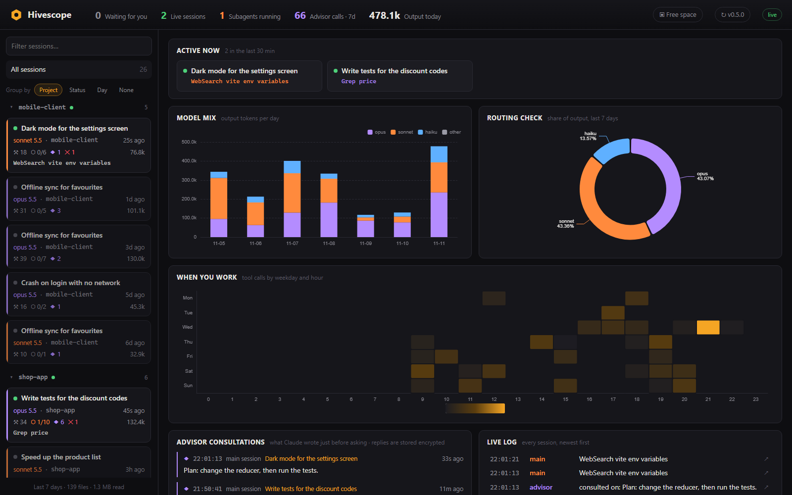
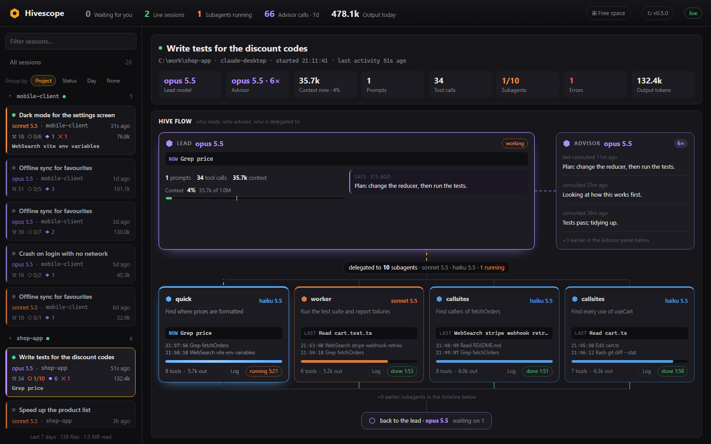

# Hivescope

A local dashboard that watches every Claude Code session on your computer: chats in the desktop app and the terminal, their subagents, advisor calls, models, tools and tokens, updating live.

It reads the transcripts Claude Code already writes to `~/.claude/projects`, so there's nothing to install or configure in Claude Code itself.



## Features

**Overview**
- **Top bar:** sessions waiting for you, live sessions, subagents running, advisor calls this week, output tokens today and today's cost.
- **Needs attention:** a session whose context is nearly full, the same tool error twice in a row, a subagent with no activity for 10 minutes, and budgets nearly reached.
- **Usage:** the current 5-hour window, today and this week, in dollars at API prices, with a chart of every 5-hour window this week. Set a budget for any of them and Hivescope tells you at 80% and 100%. See [The 5-hour window](#the-5-hour-window).
- **Active now:** every session that did something in the last 30 minutes, with what it's doing right now.
- **Model mix:** output tokens per day by model.
- **Routing check:** the share of work each model did, so you can see whether your routing to cheaper models actually happens.
- **Cost per day** by model, and **cost by project**.
- **Missed delegations:** sessions where the lead did work your routing rules hand to a cheaper subagent: five or more reads and searches in a row with nothing edited, or two or more builds and test runs in one turn. Reads of files it then edits don't count, and nothing is flagged when the lead is already as cheap as the agent.
- **When you work:** a weekday-by-hour heatmap of tool calls.
- **Advisor consultations:** every advisor call, with what Claude wrote just before asking.
- **Live log:** every session's actions as they happen, newest first.

**Sessions**
- A searchable list, grouped by project, status or day (or not at all), with collapsible groups. Hivescope remembers your choice.
- Badges on each session for running subagents, advisor calls, errors, messages with other sessions, a context that's getting full, and a session that's waiting for you.

**One session**



- Its numbers: lead and advisor models, context size, prompts, tool calls, subagents, errors, output tokens and cost, with what the advisor's calls cost.
- **Hive flow:** the lead, its advisor and every subagent it delegated to, with what each one is doing now.
- A timeline with the main session and each subagent in its own lane, the subagents table, top tools, tokens and cost by model, its possible missed delegations and the session log.

**Free space:** finds the disk space agents left behind and frees it.

**Desktop app**
- Keeps watching from the tray (Windows) or menu bar (macOS) when you close the window.
- **Notifications** when a subagent finishes, a session is waiting for you, or something needs attention. Clicking one opens that session.
- **Start with Windows / Open at login:** starts hidden in the tray.
- **Automatic updates:** installs new versions by itself, with no installer to click through (see [Updates](#updates)).

## Install

Download the newest installer from the [Releases page](../../releases/latest):

| System | File |
|---|---|
| Windows 10 / 11 | `Hivescope-Setup-<version>.exe` |
| macOS on Apple silicon (M1 and later) | `Hivescope-<version>-arm64.dmg` |
| macOS on Intel | `Hivescope-<version>-x64.dmg` |

### Windows

Run the installer. It isn't code-signed, so the first time Windows SmartScreen says "Windows protected your PC". Choose **More info**, then **Run anyway**.

### macOS

Open the `.dmg` and drag **Hivescope** into **Applications**. The app isn't notarized by Apple, so macOS blocks it the first time you open it:

1. Open Hivescope once. macOS says it can't verify the app.
2. Open **System Settings › Privacy & Security**, scroll down and click **Open Anyway**.

If macOS says the app "is damaged and can't be opened", run this once in Terminal, then open it again:

```bash
xattr -dr com.apple.quarantine /Applications/Hivescope.app
```

You only do this on the first install. Updates install without any warning.

## Updates

The desktop app checks for a new version a few seconds after it starts, and then every 6 hours. Nothing downloads until you say so. When there is one:

1. The top bar shows **⬆ Install 0.6.6** (with the new version). The tray menu has the same option, and you get a notification.
2. Click it. The update downloads, and the top bar shows **Updating …%**.
3. The download is checked against the release's checksum.
4. Hivescope closes, installs the new version silently and opens again.

To check yourself, click the version button in the top bar (**↻ v0.6.5**) or choose **Check for updates** in the tray menu. The bell next to it turns Hivescope's notifications on or off.

Updates come from this repository's latest GitHub release, so the repository must be public.

## The 5-hour window

Hivescope estimates the 5-hour window from your activity: a window starts with your first message after the last one ended, and lasts five hours. For your plan's real percentages, type `/usage` in Claude Code.

## Example: a model-routing setup

Hivescope is most useful when Claude Code hands routine work to cheaper models and saves the strongest one for judgment. Here is a setup that does that, with a lead model, an advisor and three subagents. Hivescope then shows each subagent as its own lane, every advisor consultation, in **Routing check** whether the cheaper models really do their share, and in **Missed delegations** where they didn't.

| Role | Model | Job |
|---|---|---|
| Main session | Sonnet | Does the work, and keeps design, debugging and judgment calls |
| Advisor | Opus | Reviews the plan before starting, after repeated errors, and before finishing |
| `quick` | Haiku | One lookup: a file, a fact, a page |
| `callsites` | Haiku | Every usage of a symbol, as `path:line` only |
| `worker` | Sonnet | Routine multi-step work: broad searches, research, mechanical edits, test runs |

It takes five files in your user folder, so it applies to every project:

```
~/.claude/
  settings.json        lead model and advisor
  CLAUDE.md            when to delegate, and when to ask the advisor
  agents/
    quick.md
    callsites.md
    worker.md
```

### `~/.claude/settings.json`

Add these two keys to the settings you already have:

```json
{
  "model": "sonnet",
  "advisorModel": "opus"
}
```

### `~/.claude/CLAUDE.md`

```markdown
# Global instructions

## Model routing
Hand routine work to cheaper models. You have standing permission to delegate these without asking first:

- **One-off lookups** (find a file, check one fact, summarize one doc or page) → `quick` agent (Haiku).
- **Routine multi-step work** (broad codebase searches, web research across several sources,
  summarizing many files, mechanical edits with clear instructions, running tests and reporting) → `worker` agent (Sonnet).
- **Keep in the main session**: architecture and design, debugging, anything that needs judgment,
  and anything that depends on what we've already discussed.

Don't delegate tiny tasks that a single direct tool call would answer: the agent's startup costs more than it saves.

## Agents
- `quick` (Haiku): single lookups - one file, one fact, one page.
- `callsites` (Haiku): find every usage of a function, class, or resource; returns file:line only.
- `worker` (Sonnet): self-contained routine work, builds and test runs.
- Keep design decisions in the main session.

## Advisor
The main session runs on Sonnet with Opus as the advisor (`advisorModel: opus`). Call the advisor:
- before committing to a plan or approach,
- when the same error happens twice,
- before declaring a task done.
```

### `~/.claude/agents/quick.md`

```markdown
---
name: quick
description: Cheapest helper (Haiku) for small, single-step jobs - find a file, look up one fact, read one doc or page and summarize it, check one value. Use when the answer needs no judgment and no context from the conversation.
model: haiku
tools: Read, Grep, Glob, WebSearch, WebFetch
---

You are a fast lookup helper. Do exactly the one thing you were asked.

- Don't edit files.
- Answer in a few lines: the result, where it came from (file path or URL), and anything you're unsure of.
- If the task turns out to need more than a simple lookup, say so instead of guessing.
```

### `~/.claude/agents/callsites.md`

```markdown
---
name: callsites
description: Cheap usage finder (Haiku) - finds every usage of a given function, class, method, or resource (string, config key, asset) and returns a list of file:line locations. Use when you need to know where something is referenced before changing it.
model: haiku
tools: Read, Grep, Glob
---

You find usages. Nothing else.

- Search for every reference to the symbol or resource you were given: calls, imports, subclasses, overrides,
  references from config or markup files, and string-based lookups. Try the obvious name variants.
- Don't edit files.
- Return only a list of `path:line` entries, grouped by file, with no file contents or code snippets.
- End with the total count and any places you couldn't search or matches you're unsure are the same symbol.
```

### `~/.claude/agents/worker.md`

```markdown
---
name: worker
description: Mid-cost helper (Sonnet) for routine multi-step work - broad codebase searches, web research across several sources, summarizing many files, mechanical edits with clear instructions, running tests or builds and reporting results. Use when the task is self-contained and doesn't need deep reasoning or design decisions.
model: sonnet
tools: Read, Grep, Glob, Edit, Write, Bash, WebSearch, WebFetch
---

You are a focused helper handling routine work so the main session can stay on the hard parts.

- Do the task as described; don't expand its scope or redesign anything.
- Only edit files when the task explicitly asks for edits.
- Report back concisely: what you did, what you found (with file paths or source URLs and dates), and anything uncertain or left undone.
- If you hit something that needs a real judgment call, stop and report it rather than deciding yourself.
```

**Per-project agents.** An agent in a project's own `.claude/agents/` folder only exists in that project. One example is an `audit` agent that runs the project's lint and tests before you finish. Mention it in `CLAUDE.md` as "if the project has it", so the global rules still work everywhere else.

## Run it in your browser

You need Node.js 20 or newer.

```bash
npm install
npm start
```

Then open http://127.0.0.1:4317. On Windows you can also double-click `start.cmd`, which does both and opens the page.

The first start reads the last 7 days of transcripts, which can take several seconds if you have gigabytes of them. After that it only reads new lines as they're written.

Options:

```bash
npm run serve -- --days 14     # a longer window, without rebuilding the page
npm run serve -- --port 4318   # another port
```

## Development

```bash
npm install
npm run dev        # server + hot-reloading page on http://127.0.0.1:5317
npm run desktop    # the desktop app, without installing it
npm test           # tests
npm run typecheck  # type checks
```

### Releases

Installers are built by GitHub Actions, not on your computer:

1. Raise `version` in `package.json`, for example to `0.6.0`, and commit it.
2. Tag the commit and push the tag:

   ```bash
   git tag v0.6.0
   ```

   ```bash
   git push origin v0.6.0
   ```

3. The **Release** workflow builds the Windows installer and both macOS disk images. It then publishes them as a GitHub release, together with the `windows.json` and `mac.json` manifests that installed copies update from. The tag must match the version in `package.json`, or the build stops.

To try a build without publishing it, run the **Release** workflow by hand from the **Actions** tab. Its installers are kept as workflow artifacts.

To build an installer locally anyway, use `npm run dist:win` on Windows or `npm run dist:mac` on a Mac. A local build doesn't update itself unless you set `HIVESCOPE_UPDATE_REPO=owner/repo` when building it.

## Good to know

- **The advisor's replies can't be shown.** Claude Code stores them encrypted. Hivescope shows what Claude wrote just before asking, or its last action if it wrote nothing.
- **The transcript format is internal to Claude Code** and isn't documented, so a Claude Code update could break parts of Hivescope. Everything that depends on the format is in `server/reader.ts`.
- **Your chats stay on your computer.** The server listens on 127.0.0.1 only and refuses requests addressed to any other host. The desktop app runs the same server inside itself. Don't change it to listen on your network: it exposes the content of every chat.
- **Hivescope never changes Claude Code's settings.** Budgets are saved in its own file, `~/.claude/hivescope/settings.json`.
- **The only thing that goes online is the update check.** The desktop app downloads the release manifest and installers from GitHub. Nothing about your sessions is sent.
- **Costs are API-equivalent.** They're what the tokens would cost at Anthropic's API prices (`shared/pricing.ts`), including cache reads and writes, fast mode and the advisor's own calls. On a subscription you pay a flat price instead, so use them to compare models, sessions and days. For a session that ran in one go they match the cost Claude Code records itself. They only count Claude Code on this computer.
- **Token totals count what was processed.** When Claude consults the advisor mid-response, the lead's passes and the advisor's own call are all counted, each under its model. "Context now" shows a single pass.
- **A subagent counts as running** until its transcript is marked finished, or it has had no activity for 30 minutes.
